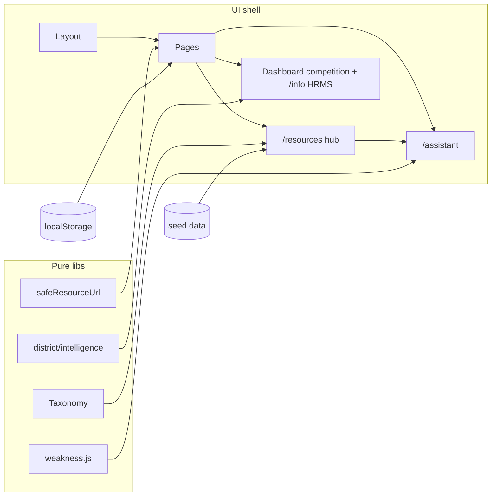

# Master Phase 0–7 — Release Candidate Notes

**Status:** Release candidate prepared locally (Phase 4 weakness + docs committed on `main`). **No deployment. No push.**  
**Branch:** `main`  
**Baseline HEAD (pre–Phase 4 gap fill):** `9ef4ed9017646fce7a7b5f9ee2a41f63737cbb4b`  
**Date (environment):** 2026-10-14

---

## 1. Repository and architecture

| Item | Verified |
|---|---|
| Primary repo (this workspace) | Vite 8 + React 19 + React Router 7 + Tailwind 3 SPA (`kru-exam-planner`) |
| Second known repo (`Deployment-kru-phuchuay-plan-2569`) | **Not available locally** — not audited in this session |
| Persistence | Client `localStorage` / `sessionStorage` only; no auth DB |
| Schedule SSOT | `kru_schedule_v1` with dual-write to legacy keys |
| Taxonomy | `src/lib/study/taxonomy.js` v`2b.1` classify-on-read |
| Deploy config present | `vercel.json` SPA rewrite — **not executed** |



### Routes

`/`, `/today`, `/overview`, `/history`, `/resources`, `/planner`, `/assistant`, `/timetable`, `/info`, `/plan`, `/quiz`, `/notes`, `/videos`, `*`

---

## 2. Phase completion status

| Phase | Status | Notes |
|---|---|---|
| 0 Baseline | Met (read-only) | Single local repo; second GitHub repo unavailable |
| 1 Safety | Met on HEAD + regression tests | `safeResourceUrl` strips `u_id`; taxonomy ignores `scheduleExamId` for content |
| 2 UI/UX | Met on HEAD | Shared `PageHeader` / `FilterChips` / `EmptyState` / `StatusBanner`; tokens in `src/index.css` |
| 3 Resource Hub | Met on HEAD | `/resources` + `hub.js` taxonomy filters |
| 4 Smart Tutor | Met | Hub lookup on prior HEAD; **quiz weakness engine** (`weakness.js` v4.1) + assistant `show_weakness` |
| 5 District | Met on HEAD | User-local competition only; no invented vacancies |
| 6 Integration QA | Met | Full Vitest suite + lint + production build (see §5); lint warning only (pre-existing unused import in audit script) |
| 7 Release prep | Met | This document committed locally; **no deploy / no push** |

---

## 3. Features implemented (this slice + prior HEAD)

- Render-time URL sanitization (`u_id` strip; http/https only).
- Unified study taxonomy (ภาค ก / ภาค ข / english-skills-a / english-major / mixed / unknown).
- Shared UI foundation on study pages.
- Study Resource Hub with taxonomy filters (never `scheduleExamId`).
- Smart Tutor: hub-backed resource lookup + **rule-based quiz weakness analysis** (`weakness.js` v`4.1`).
- District intelligence: sanitize seed rows; require user evidence; HRMS remains cited national stats on `/info`.

---

## 4. Files in this Phase 4 + release-docs commit

```
src/lib/study/weakness.js                 (new)
src/lib/study/weakness.test.js            (new)
src/lib/assistant/handlers.js
src/lib/assistant/dialogue.js
src/lib/assistant/intents.js
src/lib/assistant/assistant.test.js
src/lib/study/phaseIntegration.test.js
src/pages/Assistant.jsx
MASTER_PHASE_0_7_RELEASE.md               (new, this file)
README.md                                 (status lines for weakness + release prep)
```

Prior phases already committed through `9ef4ed9` (hub/UI/tutor/district/docs).

---

## 5. Test / lint / build

Recorded at release-prep time (re-run before commit in the same session):

| Command | Result |
|---|---|
| `npm test` | **114 passed** / 19 files (exit 0) |
| `npm run lint` | exit 0; 1 warning: unused `subjectIdsFromText` in `scripts/phase-i-journey-audit.mjs` (pre-existing; unchanged in this commit) |
| `npm run build` | **Success** (exit 0) |

---

## 6. Source inventory (verified from seed modules)

| Metric | Reported earlier | Actual now |
|---|---|---|
| Resource inventory rows | 89 | **89** (`withUidFlag` 40) |
| HTML planned tasks | 139 | **139** (34 days) |
| Quizzes / questions | 7 / 35 | **7 / 35** |
| Notes | 4 | **4** |
| Videos | 39 | **39** |
| Hub catalog items | — | **60** (quizzes+notes+videos+plan+important links) |
| Exam ภาค ก | 14 Nov 2569 | `2026-11-14T09:00:00+07:00` |
| Exam ภาค ข | 15 Nov 2569 | `2026-11-15T09:00:00+07:00` |

---

## 7. Data integrity

- Seed URLs with `u_id` remain in source; stripped only at render via `safeResourceUrl`.
- Taxonomy does not mutate source records; `scheduleExamId` is scheduling metadata only.
- Weakness engine is pure: caller passes `quiz_results`; never writes storage; does not alter schedule.
- Dual-write storage hardening already on HEAD (`d73d6f1`).
- No destructive migration executed.

---

## 8. UI/UX

- Design tokens / component classes in `src/index.css` (`btn-*`, `card`, `input`, `:focus-visible`).
- Shared primitives under `src/components/ui/`.
- Thai labels preserved; ภาค ก vs ข and English skills vs major distinguished in hub filters and tutor.

---

## 9. Smart Tutor capabilities and limits

**Can:** classify intents; show today/exams/progress; find hub resources; analyze `quiz_results` for observed weakness vs insufficient data; recommend practice from catalog; preview schedule changes with confirm.

**Cannot:** LLM reasoning; cross-device sync; invent weaknesses without attempts; auto-write timetable without confirm; promise pass probability.

---

## 10. District Intelligence

- Provenance: **user-local** `competition_rates_v1` (after seed strip).
- Missing measured-at / source URL → issues / incomplete, not invented.
- National HRMS on `/info` is separate cited stats — not district openings.
- No live district API integrated.

---

## 11. Remaining limitations / risks

1. Second historical repo not inspected locally.
2. Seed `u_id` scrub in HTML inventory still **deferred** (privacy vs login deep-links).
3. No automated visual regression suite; manual/browser QA is supplemental.
4. Weakness threshold defaults (`MIN_ATTEMPTS_FOR_WEAKNESS=1`, `WEAKNESS_PCT_THRESHOLD=70`) are product knobs — documented in code.
5. Lint warning in journey audit script left untouched (out of Phase 4 scope).

---

## 12. Security / privacy

- No secrets in frontend bundle for LLM/paid APIs.
- External links: http/https only; `u_id` stripped at render.
- Progress stays in browser storage.
- Do not commit API keys.

---

## 13. Release checklist (operator)

1. Review the Phase 4 weakness + docs commit on `main`.
2. `npm test && npm run lint && npm run build`
3. Smoke: `/resources`, `/assistant` → “ดูจุดอ่อน”, Dashboard competition empty state, `/info`.
4. Push and deploy **only** after separate explicit approval (neither done in this prep).

---

## 14. Rollback

- **This Phase 4 + docs commit:** `git revert <commit>` (preferred) or restore the parent `9ef4ed9` only if authorized and no later commits depend on it. Do not `git reset --hard` without user request.
- **Earlier HEAD features:** revert specific commits (`c977430` hub, `f4c3ff6` tutor hub, `39733e5` district, `b1d8568` UI) if a slice must be undone.
- User localStorage keys are backward-compatible; no forced wipe.

---

## 15. Local commands

```bash
npm install
npm run dev          # http://127.0.0.1:43123
npm test
npm run lint
npm run build
npm run preview
```

---

## 16. Explicit non-actions

- **No deployment** performed.
- **No `git push`** performed.
- Second known GitHub repository was not available locally and was not audited.
